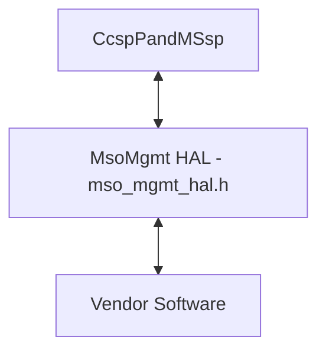
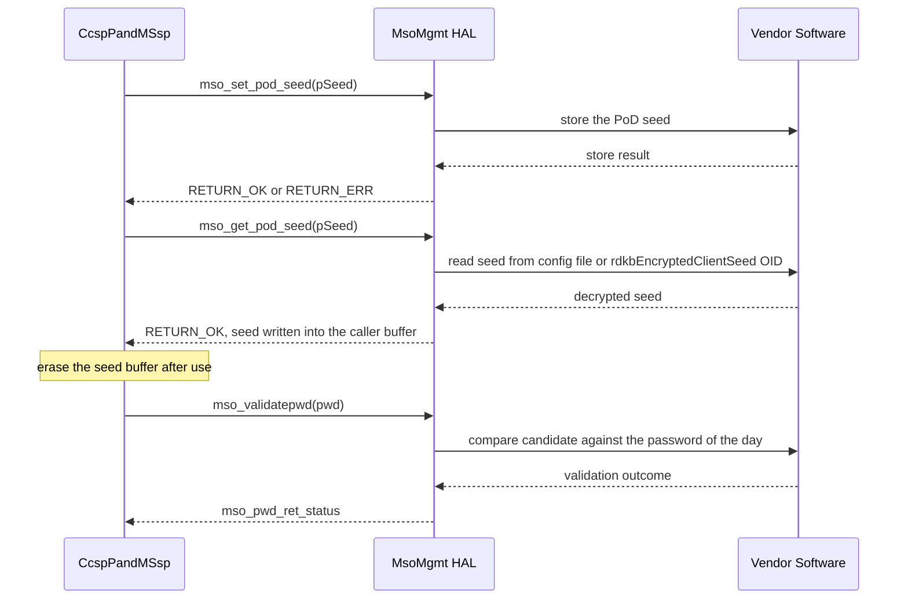

# MsoMgmt HAL Documentation

## Version History

| Date | Comment | Version |
| --- | --- | --- |
| 2024-06-10 | Initial release. MSO HAL header migration to GitHub (RDKB-52500), refined against MTA HAL review comments. | 1.0.0 |
| 2026-08-24 | Specification rebuilt against `include/mso_mgmt_hal.h`. A previously documented initialization and teardown lifecycle, its context handle type, and a device-status call were removed: this interface has never declared any of them. Canonical topic set completed. | Unreleased |

## Acronyms

- `HAL` \- Hardware Abstraction Layer
- `RDK-B` \- Reference Design Kit for Broadband Devices
- `MSO` \- Multiple System Operator
- `PoD` \- Password of the Day
- `API` \- Application Programming Interface
- `ABI` \- Application Binary Interface
- `OEM` \- Original Equipment Manufacturer
- `DOCSIS` \- Data Over Cable Service Interface Specification
- `SNMP` \- Simple Network Management Protocol
- `OID` \- Object Identifier
- `SLA` \- Service Level Agreement

## Description

The diagram below describes the high-level software architecture of the MsoMgmt HAL module stack.

The MsoMgmt HAL is the interface through which `CcspPandMSsp` validates an operator's **password of the day** and manages **the `PoD` seed** from which that password is derived. The `OEM` or third-party vendor supplies the implementation behind the interface.

The declared contract is exactly three functions: one password-validation call and two seed accessors, listed under `API Surface`. The header's file-level description of `DOCSIS` device management in `MSO` environments describes the deployment context only: no declaration provisions a device, reads or writes a data model, delivers an event notification, or performs any security operation other than validating a candidate password.

## Optional Components

The following implementation behaviours vary by vendor and device class.

- Seed source — `mso_get_pod_seed` obtains the seed either from the device configuration file or from the `rdkbEncryptedClientSeed` `SNMP` `OID`, at the vendor's discretion. Either source satisfies the contract.
- On-demand seed decryption — on newer broadband devices the implementation decrypts the seed on demand when `mso_set_pod_seed` is called.

None of the three functions is optional.

## Component Runtime Execution Requirements

### Initialization and Startup

The interface has no initialization or de-initialization entry point: a caller invokes any of the three functions directly, without opening or closing a session.

The MsoMgmt HAL has no explicit dependencies on other APIs.

The three functions available to a caller are:

- `mso_validatepwd()`
- `mso_set_pod_seed()`
- `mso_get_pod_seed()`

Third-party vendors must implement this HAL according to their system's specific requirements.

### Threading Model

There is no requirement to make this interface thread safe. Any module that invokes the API must ensure calls are made in a thread-safe manner.

Vendors may implement internal threading and event mechanisms to meet their operational requirements. These mechanisms must be designed to ensure thread safety when interacting with the HAL interface. Proper cleanup of allocated resources (memory, file handles, threads) is mandatory when the vendor software terminates or closes its connection to the HAL.

### Process Model

All APIs are expected to be called from multiple processes. Vendors must implement protection mechanisms within their API implementations to handle multiple processes calling the same API simultaneously, to ensure data integrity and prevent race conditions.

### Memory Model

The caller supplies every buffer this interface touches. No function returns a pointer, so ownership never transfers between the caller and the HAL.

#### Caller Responsibilities

- Allocate, own and release every buffer passed to the interface, and pass a valid, non-`NULL` pointer to every call.
- Pass `mso_validatepwd` a NUL-terminated candidate password.
- Provide a buffer of at least 64 bytes to `mso_set_pod_seed` and `mso_get_pod_seed`. Zero the `mso_get_pod_seed` buffer before the call and bound every read of the result by those 64 bytes rather than by a terminator.
- Do not share a buffer with another thread for the duration of a call.
- Erase the seed `mso_get_pod_seed` returns once it has been used, on the failure path as well as the success path, with a write the compiler cannot optimise away.
- Before erasing any buffer that held a password or seed, establish with the vendor that the implementation retains no pointer to it after the call returns.

#### Module Responsibilities

- Handle and deallocate memory used for internal operations, releasing it upon closure to prevent leaks.
- Do not retain a caller-supplied pointer after the call returns.

### Power Management Requirements

The HAL is not involved in any of the power management operations.

### Asynchronous Notification Model

There are no asynchronous notifications; every result is returned by the call that produces it.

### Blocking calls

**Synchronous and Responsive:** All APIs within this module should operate synchronously and complete within a reasonable timeframe based on the complexity of the operation.

**Timeout Handling:** To ensure resilience in cases of unresponsiveness, vendors should implement appropriate timeouts within their implementations where failure due to lack of response is a possibility.

### Internal Error Handling

**Synchronous Error Handling:** All APIs must return errors synchronously as a return value. This ensures immediate notification of errors to the caller.

**Internal Error Reporting:** The HAL is responsible for reporting any internal system errors, such as out-of-memory conditions, through the return value. A failure value does not identify its cause, so a caller acts on the value itself:

| Return value | Returned by | Caller action |
| --- | --- | --- |
| `Good_PWD` | `mso_validatepwd` | Proceed; this is the only value that authorises the request. |
| `Invalid_PWD`, `Unique_PWD` | `mso_validatepwd` | Deny the request. |
| `Expired_PWD` | `mso_validatepwd` | Deny the request and obtain a current password rather than retrying the same value. |
| `TimeError` | `mso_validatepwd` | Treat the verdict as inconclusive: deny the request for now and retry once device time is available. |
| `RETURN_OK` | `mso_set_pod_seed`, `mso_get_pod_seed` | Proceed. |
| `RETURN_ERR` | `mso_set_pod_seed` | Re-check the supplied seed and retry, and install a known seed before relying on validation again. |
| `RETURN_ERR` | `mso_get_pod_seed` | Treat the seed as unavailable and do not read the buffer as a seed. |

**Focus on Logging for Errors:** For system errors, the HAL should prioritize logging the error details for further investigation and resolution. A failure is logged by naming the operation and its return value.

### Persistence Model

There is no requirement for the HAL to persist any setting information. Seed storage is a vendor implementation matter; `Optional Components` names the two seed sources.

## Non functional requirements

The following non functional requirements should be supported by the component.

### Logging and debugging requirements

The component is required to record all errors and critical informative messages to aid in identifying, debugging, and understanding the functional flow of the system. Logging should be implemented using the `syslog` method, as it provides robust logging capabilities suited for system-level software. The use of `printf` is discouraged unless `syslog` is not available.

All HAL components must adhere to a consistent logging process. When logging is necessary, it should be performed into the `mso_vendor_hal.log` file, which is located in either the `/var/tmp/` or `/rdklogs/logs/` directories.

Logs must be categorized according to the following log levels, as defined by the Linux standard logging system, listed here in descending order of severity:

- **FATAL:** Critical conditions, typically indicating system crashes or severe failures that require immediate attention.
- **ERROR:** Non-fatal error conditions that nonetheless significantly impede normal operation.
- **WARNING:** Potentially harmful situations that do not yet represent errors.
- **NOTICE:** Important but not error-level events.
- **INFO:** General informational messages that highlight system operations.
- **DEBUG:** Detailed information typically useful only when diagnosing problems.
- **TRACE:** Very fine-grained logging to trace the internal flow of the system.

Each log entry should include a timestamp, the log level, and a message describing the event or condition. This standard format will facilitate easier parsing and analysis of log files across different vendors and components.

Implementations must not log credentials, secrets, security-sensitive information, or other sensitive data. The rule applies at every log level, including `DEBUG` and `TRACE`, and equally to traces, error messages, crash dumps, support bundles and telemetry; it binds every caller of the interface as well. A message concerning a sensitive value names the operation and its outcome, never the value or any fragment, hash or length of it.

### Memory and performance requirements

Vendors may allocate memory internally for their specific operational needs; `Memory Model` sets out the ownership rules for that memory and for caller buffers. Response-time expectations are those under `Blocking calls`.

### Quality Control

To ensure the highest quality and reliability, it is strongly recommended that third-party quality assurance tools such as `Coverity`, `Black Duck` and `Valgrind` be employed to thoroughly analyze the implementation. The goal is to detect and resolve potential issues such as memory leaks, memory corruption, or other defects before deployment.

Furthermore, both the HAL wrapper and any third-party software interacting with it must prioritize robust memory management practices. This includes meticulous allocation, deallocation, and error handling to guarantee a stable and leak-free operation.

Any change to a file listed under `Source References` obliges a review of this specification by the repository's code owner, `@rdkcentral/rdkb-hal-advisory`.

### Licensing

The implementation is expected to be released under the Apache License 2.0, the license the interface header carries.

### Build Requirements

The source code should be capable of, but not be limited to, building under the Yocto distribution environment. The recipe should deliver a shared library named `libhal_msomgmt.so`.

### Variability Management

The role of adjusting the interface, guided by versioning, rests solely within architecture requirements. Thereafter, vendors are obliged to align their implementation with a designated version of the interface. As per `SLA` terms, they may transition to newer versions based on demand needs.

Each API interface will be versioned using [Semantic Versioning 2.0.0](https://semver.org/spec/v2.0.0.html); the vendor code will comply with a specific version of the interface.

### Platform or Product Customization

Every declaration is unconditional: no compile flag excludes any function, macro or type, so a conforming implementation presents the same three functions with the same signatures on every product. The seed source and on-demand decryption described under `Optional Components` vary by implementation without changing the interface.

## Interface API Documentation

All HAL function prototypes and datatype definitions are available in the `mso_mgmt_hal.h` file.

1. Components/Processes must include `mso_mgmt_hal.h` to make use of MsoMgmt HAL capabilities.
2. Components/Processes should add a linker dependency for `libhal_msomgmt.so`.

Per-API detail — argument ranges, pre-conditions, every return value and the reason for it — is carried by the Doxygen documentation on each declaration in that header.

### Theory of operation and key concepts

This interface lets `CcspPandMSsp` check whether a password offered to the device matches the operator's password of the day, and maintain the `PoD` seed from which that password is derived.

Two concepts carry the whole contract:

- **Password of the day** — the credential valid for the `MSO` user for the current day. `mso_validatepwd` compares a caller-supplied candidate with it and returns a verdict; a caller can submit a candidate but cannot read or generate the password.
- **The `PoD` seed** — the value from which the daily password is generated. `mso_set_pod_seed` installs it and `mso_get_pod_seed` returns it, decrypted, into a caller buffer. The derivation function is not part of this interface.

Both values are credentials, and the seed is the more sensitive: every daily password derives from it.

#### Object Lifecycles

The interface is a value-passing boundary with no objects or handles, so there is no lifecycle to manage. The caller owns every buffer that crosses the boundary, as `Memory Model` sets out.

#### Method Sequencing

The interface requires no call order. The relationship between the calls is logical: a seed has to be in place for a password generated from it to validate, so a caller ensures a seed is in place before relying on an `mso_validatepwd` verdict.

`mso_set_pod_seed` and `mso_get_pod_seed` are not a matched pair: `mso_get_pod_seed` reads the seed from its own sources, and the seed it returns is not guaranteed to be the one last installed.

#### State-Dependent Behavior

The `mso_validatepwd` verdict depends on the `PoD` seed installed through `mso_set_pod_seed` and on the current device time: a recognised candidate that is no longer valid for the current day yields `Expired_PWD`, and a time-related failure such as an unsynchronised device clock yields `TimeError`. Neither dependency is exposed as a state with defined transitions; `State Diagram` lists the status values a caller can observe.

### Data Structures and Defines

The types and defines a caller interprets are listed below.

`mso_pwd_ret_status` — a `typedef enum` and the return type of `mso_validatepwd`. A caller must handle all five members:

| Member | Meaning |
| --- | --- |
| `Invalid_PWD` | Password is invalid. |
| `Good_PWD` | Password is valid. |
| `Unique_PWD` | Password is unique, meaning not previously used. |
| `Expired_PWD` | Password is expired. |
| `TimeError` | A time-related error occurred during validation. |

**Defines** — `RETURN_OK` and `RETURN_ERR` are the return domain of both seed accessors, which return `INT`:

| Define | Value | Meaning |
| --- | --- | --- |
| `RETURN_OK` | `0` | Success. |
| `RETURN_ERR` | `-1` | Failure; the only failure value either seed accessor defines. |
| `ERROR` | `-1` | Legacy failure constant, numerically identical to `RETURN_ERR` and returned by no declared function. |
| `SIZE_arrisCmDevHttpClientSeed` | `8L` | Legacy element count referenced by no declaration; seed buffers are sized from the 64-byte requirement, not from this constant. Its include guard is spelled `SIZE_arrisCmDevHttpClientSee`, so pre-defining the macro does not suppress this definition. |
| `SEC_PER_YEAR` | `31536000` | Seconds in a 365-day year, provided for legacy callers. |

**Compatibility aliases** — the guarded macros `CHAR`, `UCHAR`, `BOOLEAN`, `INT`, `UINT`, `ULONG`, `TRUE`, `FALSE` and `ENABLE`, and the typedefs `uint16`, `uint32` and `boolean`, exist for source and `ABI` compatibility with legacy RDK-B translation units; a guarded macro yields to a definition already in effect. Only `INT` appears in a declared signature, as the return type of both seed accessors.

### API Surface

Every function this interface declares is named below by exact identifier.

**Password validation** — one call, returning the `mso_pwd_ret_status` enumeration:

- `mso_validatepwd` — validates a caller-supplied password against the current `MSO` password of the day.

**Password-of-the-Day seed** — two accessors, both returning `RETURN_OK` or `RETURN_ERR`:

- `mso_set_pod_seed` — installs the `PoD` seed used to generate the daily password.
- `mso_get_pod_seed` — retrieves the decrypted `PoD` seed into a caller-supplied buffer.

### Sequence Diagram

The exchange below shows `CcspPandMSsp` calling the three declared functions. The order shown is one seed-then-validate flow, not a required sequence; see `Method Sequencing`.

Mermaid diagrams render on GitHub, where `README.md` presents this page; the generated Doxygen site shows their source text.

### State Diagram

No state diagram is drawn: the interface defines status values but no transitions between them. The values a caller can observe are:

- `mso_pwd_ret_status` — `Invalid_PWD`, `Good_PWD`, `Unique_PWD`, `Expired_PWD`, `TimeError`.
- The seed-accessor status domain — `RETURN_OK` and `RETURN_ERR`.

## Source References

- [rdkcentral/rdkb-halif-mso/include/mso_mgmt_hal.h](https://github.com/rdkcentral/rdkb-halif-mso/blob/develop/include/mso_mgmt_hal.h) — interface header: declarations, types, defines and per-API Doxygen documentation
- [rdkcentral/rdkb-halif-mso/CHANGELOG.md](https://github.com/rdkcentral/rdkb-halif-mso/blob/develop/CHANGELOG.md) — release history recorded in `Version History`
- [rdkcentral/rdkb-halif-mso/.github/CODEOWNERS](https://github.com/rdkcentral/rdkb-halif-mso/blob/develop/.github/CODEOWNERS) — code owner named under `Quality Control`
- [rdkcentral/rdkb-halif-mso/LICENSE](https://github.com/rdkcentral/rdkb-halif-mso/blob/develop/LICENSE) — Apache License 2.0 text named under `Licensing`
